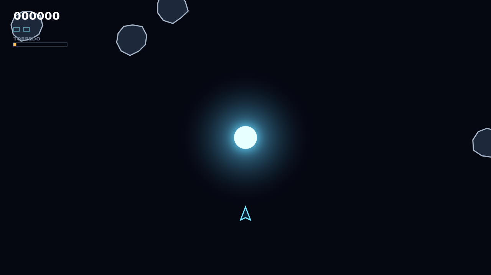

# Shatter

Shatter drops you into a wrapping field of armored rocks circling a brilliant gravity well. Fly by momentum, carve the big ones into smaller and faster fragments, and finish every shard to bring on the next wave.

The star changes every shot. Bullets bow toward its core, opening bank shots onto targets hidden on the far side, while rocks slingshot through the same pull and return from the edge if the star swallows them.

When armor will not crack quickly enough, launch your single homing torpedo. It flies straight through the well, seeks the nearest target in its forward cone, and destroys any rock outright—but the next warhead takes ten tense seconds to recharge.

The roaming saucer makes patience dangerous. It weaves across the field, fires on your current position, and turns an already lively orbit into a hunt.

